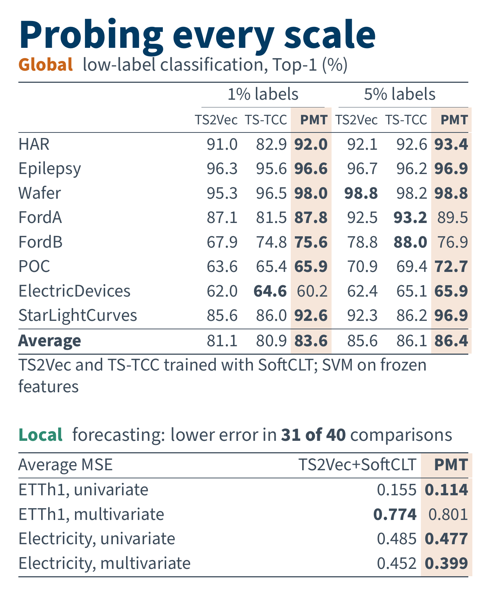

<h1 align="center">Progressive Memory Transformer</h1>

<p align="center"><b>Memory-Aware Attention for Time-Series</b><br>NeurIPS 2026</p>

<p align="center">
Tord Sture Stangeland<sup>1,2</sup> · Andreas Köhler<sup>2,3</sup> · Steffen Mæland<sup>2,4</sup> · Adín Ramírez Rivera<sup>1</sup><br>
<sup>1</sup>University of Oslo · <sup>2</sup>NORSAR · <sup>3</sup>UiT The Arctic University of Norway · <sup>4</sup>Western Norway University of Applied Sciences
</p>

<p align="center">
<a href="https://openreview.net/forum?id=jyIfuVt2UU"><b>Paper</b></a> ·
<a href="https://arxiv.org/abs/2609.31351"><b>arXiv</b></a> ·
<a href="https://dsb-ifi.github.io/pmt/"><b>Project page</b></a> ·
<a href="https://github.com/dsb-ifi/pmt/releases/download/v1.0.0/pmt_poster.pdf"><b>Poster</b></a> ·
<a href="https://github.com/dsb-ifi/pmt/releases/download/v1.0.0/pmt_method_720p.mp4"><b>Video</b></a>
</p>

<p align="center">
<a href="https://openreview.net/forum?id=jyIfuVt2UU"></a>
<a href="https://arxiv.org/abs/2609.31351"></a>
<a href="LICENSE"></a>

</p>

PMT learns time-series representations without labels. Its Progressive Memory Attention blocks pass memory across windows and between blocks.

<p align="center"></p>

Training supervises three levels of this hierarchy: HGCL on the tokens, PCL on the memory states, and ICL on the sequence summary.

<p align="center"></p>


https://github.com/user-attachments/assets/ea63f9f9-bdc6-4e4c-b06e-4584578988cd


## Results

Probes on frozen PMT features against TS2Vec and TS-TCC, both trained with SoftCLT. [Paper tables](paper/README.md) · [Results per run](results/README.md)

<p align="center"></p>

## Install

Use Python 3.11 and run the commands from the repository root.

```bash
python3.11 -m venv .venv
source .venv/bin/activate
```

Install PyTorch before the core requirements: the CPU build for a CPU-only install, or the CUDA 12.8 build for an NVIDIA GPU. On the ARM64 GH200 test host, the default PyPI wheel had no CUDA support. With both extras, the tested CPU-only and CUDA environments used about 1.6 and 6.9 GiB. [PyTorch wheels](https://download.pytorch.org/whl/torch/)

```bash
# CPU only
python -m pip install torch==2.10.0 --index-url https://download.pytorch.org/whl/cpu
# NVIDIA GPU
python -m pip install torch==2.10.0+cu128 --index-url https://download.pytorch.org/whl/cu128
```

```bash
python -m pip install -r requirements.txt
# Optional extras for xLSTM and Electricity preparation
python -m pip install -c requirements.txt -r requirements-optional.txt
```

To install just one extra, use `python -m pip install -c requirements.txt xlstm==2.0.4` or `python -m pip install -c requirements.txt pandas==2.2.3`. The constraint keeps NumPy at 1.23.5. On a GPU host, `python -c "import torch; print(torch.cuda.is_available())"` should print `True`.

## Quick start

Download a dataset and train PMT with the paper's recipe for it. For the UCR archive, follow the clue in the briefing's **The Password** section. [UCR archive briefing](https://www.cs.ucr.edu/~eamonn/time_series_data_2018/BriefingDocument2018.pdf) · [Other datasets](data/README.md)

```bash
python scripts/download_data.py --only ucr --ucr-password '<archive password>'
python scripts/train.py --dataset UCR_PhalangesOutlinesCorrect
```

Training uses CUDA when available and took about 12 minutes on one NVIDIA GH200. Each file in [`configs/`](configs/) is the paper's recipe for one dataset, written as changes to [`configs/base.yaml`](configs/base.yaml). Use `--seed N` for another seed and `--override key=value` to change any setting.

The run writes to `runs/<dataset>_s<seed>/`:

- `encoder.pt`: the encoder after the last epoch.
- `best_encoder.pt` and `best_encoder_5pct.pt`: the encoders from the probe with the best accuracy at 1% and 5% labels.
- `metrics.json`: the loss and probe history.

For a quick check, run one optimizer step and the final probe. This took about 30 seconds on two CPU cores.

```bash
python scripts/train.py --dataset UCR_PhalangesOutlinesCorrect --run-dir runs/smoke \
  --override train.device=cpu --override train.epochs=1 \
  --override train.steps=1 --override optim.batch_size=2
```

## Train on your own data

Save each split as a dictionary with `samples` of shape `[N, C, T]` and integer `labels` of shape `[N]`.

```python
import torch

for split, (x, y) in {'train': (x_train, y_train), 'val': (x_val, y_val), 'test': (x_test, y_test)}.items():
    torch.save({'samples': torch.as_tensor(x).float(), 'labels': torch.as_tensor(y).long()}, f'data/my_data/{split}.pt')
```

Then write a recipe next to the others, for example `configs/my_data.yaml`, and train it.

```yaml
extends: base.yaml
data: {name: my_data}
```

```bash
python scripts/train.py --config configs/my_data.yaml
```

The number of channels, the length and the number of classes are read from the training split. Training uses no labels. The probes use them to fit an RBF SVM on frozen features with 1% and 5% of the training labels and tune it on the validation split. Normalization statistics come from the training split.

The paper's recipes differ mainly in the tokenizer patch (`model.kernel`, `model.stride`), the memory window (`pma.window`, `pma.stride`) and the loss weights (`loss.hgcl_weight`, `loss.icl_weight`, `loss.pcl_weight`). To start from the closest paper dataset, extend its recipe instead of `base.yaml`.

## Use an encoder

`pmt.load_encoder` returns a module that takes raw series of shape `[B, C, T]`, applies the training normalization saved with the encoder, and returns its features.

```python
import torch
import pmt

encoder = pmt.load_encoder('runs/my_data_s42/encoder.pt')
with torch.no_grad():
    features = encoder(x)
```

| Field | Shape | Content |
| --- | --- | --- |
| `cls` | `[B, D]` | Sequence summary |
| `tokens` | `[B, N, D]` | Token embeddings |
| `pma_states` | `[B, W, S, D]` | Memory slots written by each window |
| `pma_final` | `[B, S, D]` | Memory after the last window |
| `mask` | `[B, N + 1]` | Valid positions, summary first |

The paper's probes read `cls` on most classification datasets and max-pool `tokens` on HAR, StarLightCurves and the forecasting datasets.

## Evaluate

`scripts/evaluate.py` fits the RBF SVM probe on a saved encoder at 1% and 5% labels with a fresh grid for `C` and `gamma`. `--run-svm` refits a `best_encoder.pt` or `best_encoder_5pct.pt` with its saved `C` and `gamma`. `--draws N` repeats the probe across label-noise draws.

```bash
python scripts/evaluate.py --checkpoint runs/UCR_PhalangesOutlinesCorrect_s42/encoder.pt
python scripts/evaluate.py --checkpoint runs/UCR_PhalangesOutlinesCorrect_s42/best_encoder.pt --run-svm --draws 3
```

By default, evaluation reads `data/`, runs on CPU, and writes `runs/evaluate/metrics.json`. Use `--data-root`, `--device cuda`, or `--out` to change those defaults.

## Reproduce the paper

Every training run in the paper is registered by its ID, which includes the seed. [Run registry](configs/runs.yaml)

```bash
python scripts/train.py --list
poc=pocconfirm_20261018_UCR_PhalangesOutlinesCorrect_confirmation_s42
python scripts/train.py --id "$poc"
```

On one NVIDIA GH200, full runs took about 12 minutes for PMT on POC, 35 minutes for sPMA on FordA, and 100 minutes for PMT on HAR, including their scheduled probes.

Training is repeatable: on the same GPU and software, a seed gives identical weights and metrics.

**Table 1.** `best_encoder.pt` and `best_encoder_5pct.pt` hold the encoders from the best scheduled probe at 1% and 5% labels, the probes Table 1 reports. [Paper Table 1](paper/tables/table1_classification.tex)

**Table 2.** Use `--cue` to replay the six cue settings. On two CPU cores, a one-step FordA run with training batch size 16 took about 20 minutes including the final probes. Standalone cue replay took about 15 minutes.

```bash
python scripts/evaluate.py --checkpoint runs/table2_cue_UCR_FordA_pmt_main_s42/encoder.pt --cue
```

**Table 3.** Forecast replay requires validation metrics at epochs 2, 6, 10, 20, 30, 40, and 50, so keep the milestone checkpoints from training. It selects the encoder by mean validation MAE, breaking ties by validation MSE and then the earlier epoch, and selects each horizon's ridge penalty on validation before scoring test. For a shortened run, use `--checkpoint` with its final `encoder.pt` to score the test split.

```bash
python scripts/evaluate.py --replay-run runs/table3_pmt_uni_etth1_s43
```

At sliding batch 256, standalone ETTh1 CPU validation, test scoring, and Table 3 replay peaked at 2.85, 3.38, and 3.03 GiB of RAM. Electricity's 321 measurement columns and seven calendar covariates give 328 inputs in multivariate mode and eight in univariate mode. Electricity training needs a GPU: a batch-128 CPU step exceeded 57 GiB of RAM. The paper trained it on NVIDIA GH200 nodes. Univariate Electricity validation peaked at 2.64 GiB. Multivariate validation needs more than 68 GiB of RAM because, as in the SoftCLT protocol, the ridge fit holds the 720-step targets for all channels in float64.

**Compare.** Point the summarizer at finished runs, after any forecast replay. It writes `runs/runs.csv` and `runs/table3_per_seed.csv` and compares them with the archived results. Move incomplete run directories out of the directory you summarize. [Classification results](results/runs.csv) · [Forecast results](results/table3_per_seed.csv)

```bash
python scripts/summarize.py --runs-dir runs
```

## Cite

```bibtex
@inproceedings{
stangeland2026progressive,
title={Progressive Memory Transformer: Memory-Aware Attention for Time-Series},
author={Tord Sture Stangeland and Andreas K{\"o}hler and Steffen Maeland and Ad{\'\i}n Ram{\'\i}rez Rivera},
booktitle={The Fortieth Annual Conference on Neural Information Processing Systems},
year={2026},
url={https://openreview.net/forum?id=jyIfuVt2UU}
}
```

[Citation metadata](CITATION.cff) · [Paper tables and figures](paper/README.md) · [MIT license](LICENSE)
